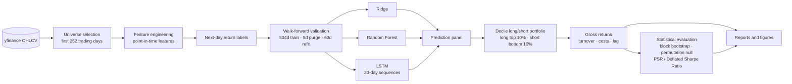
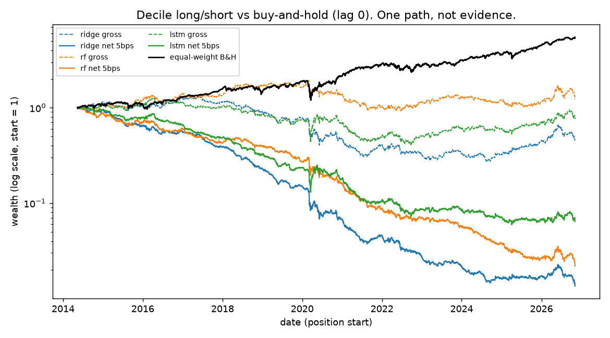
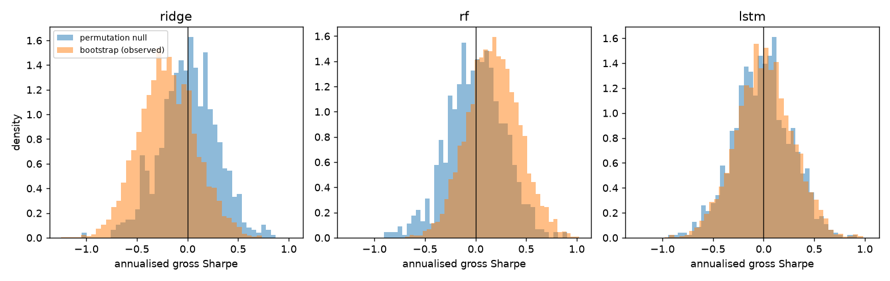

# Stock Return Predictor

<p align="center">
  <strong>Test whether machine learning can predict next-day US equity returns — without leaking the future.</strong><br/>
  Ridge, Random Forest and LSTM models evaluated with walk-forward validation, decile long/short portfolios, trading costs, block bootstrap, permutation tests, and the Deflated Sharpe Ratio.
</p>

<p align="center">
  
  
  
  
  
  
  
</p>

**Headline result: no tradable edge.**

Stock Return Predictor tests whether simple machine-learning models can extract a tradable next-day signal from daily US equity data. The project deliberately treats the backtest as an empirical test rather than a search for a flattering equity curve.

Across Ridge, Random Forest, and LSTM models, gross Sharpe is statistically indistinguishable from zero with both same-close execution and a one-day execution lag. Once trading costs are applied, every tested configuration becomes strongly negative.

The important result is therefore the **evidence for the absence of a robust edge**, not the existence of a profitable backtest.

## What was built

`data → features → labels → walk-forward models → decile long/short → metrics → Monte Carlo → report`

The implementation lives in `src/srp/`, with experiment parameters centralized in `configs/default.yaml`.

- **Data:** yfinance daily adjusted OHLCV from 2012-01-01 to 2026-11-06. The universe contains the top 75 of approximately 150 large-cap candidates by mean dollar volume during the **first 252 trading days only**, avoiding look-ahead in universe selection. Final panel: 3,733 days × 75 tickers.
- **Features:** all features use information available at or before date `t`: 1/2/3/5/10/21-day returns, 5/10/20/50-day moving-average ratios, RSI(14), 5/21-day volatility and their ratio, volume z-score, and high-low range. Cross-sectional features are rank-normalized to [-1, 1] each day. Equal-weight market return and market volatility are also included.
- **Target:** next-day close-to-close return, winsorized at the 1st/99th percentiles and demeaned across stocks each day. Portfolio evaluation uses the raw return.
- **Validation:** expanding window with a 504-day initial training period, 63-day refits, a **5-day purge** before every test block, and 50 walk-forward folds. Out-of-sample period: 2014-05-13 to 2026-11-04, covering 3,140 days. Train/test dates are never shuffled.
- **Models:** Ridge (alpha 1000), Random Forest (200 trees, depth 6, `min_samples_leaf=500`, `max_features=0.33`), and an LSTM using 20-day sequences of 7 features with hidden size 16. Hyperparameters were fixed before evaluating test results; no test-driven tuning was performed.
- **Portfolio:** each day, long the top prediction decile and short the bottom decile with equal weights. The portfolio is dollar-neutral with long leg +1 and short leg -1, and returns are reported per $1 of long-leg notional.

## Architecture

The pipeline keeps data preparation, model fitting, portfolio construction, statistical evaluation, and reporting separate. This makes the backtest easier to audit and, importantly, keeps future information outside the training and feature-generation paths.



## How to run

Requirements: **Python 3.12**, CPU-compatible PyTorch, and `make`.

```bash
make setup       # create environment and install dependencies
make data        # download/cache OHLCV and select the universe
make features    # build point-in-time features
make train       # train all models (~22 min on CPU; LSTM dominates)
make backtest    # run walk-forward predictions and portfolio backtest
make montecarlo  # bootstrap, permutation null, PSR/DSR
make report      # generate figures and tables under results/
make test        # run 26 tests
make lint        # Ruff checks and formatting
```

To run the complete pipeline:

```bash
python scripts/run_all.py all
```

The data is downloaded and cached locally; model artifacts and generated reports are not required to be stored in the repository.

## Results

All reported figures below are out-of-sample over **2014-05 to 2026-11**. Sharpe ratios are annualized from daily returns with a zero risk-free rate.

**Execution conventions**

- **Lag 0:** trade at the close at which the signal was computed.
- **Lag 1:** enter one close later.
- **Costs:** basis points per side on traded notional.

### Predictive power

| Model | Mean IC | IC t-stat (naive) | OOS R² vs. zero |
|---|---:|---:|---:|
| Ridge | 0.0071 | 1.98 | -0.0002 |
| Random Forest | 0.0053 | 1.56 | -0.0001 |
| LSTM | 0.0034 | 0.91 | -0.0002 |

ICs are extremely small, and none of the models beats a zero forecast in out-of-sample R². The naive t-statistics assume daily ICs are independent and therefore represent an optimistic interpretation. None is convincing after accounting for six model/lag trials.

### Portfolio: cost and lag sensitivity

| Model | Lag | 0 bps (gross) | 5 bps | 10 bps |
|---|---:|---:|---:|---:|
| Ridge | 0 | -0.21 | -1.52 | -2.83 |
| Ridge | 1 | 0.14 | -1.18 | -2.49 |
| Random Forest | 0 | 0.18 | -1.33 | -2.85 |
| Random Forest | 1 | -0.07 | -1.63 | -3.18 |
| LSTM | 0 | 0.01 | -0.92 | -1.84 |
| LSTM | 1 | 0.06 | -0.87 | -1.80 |
| Equal-weight buy-and-hold (long-only, no costs) | — | 0.85 | — | — |

Daily turnover ranges from 1.6 to 2.6, measured as the sum of absolute weight changes on a gross book of 2. At 5 bps per side, that turnover translates to approximately 20–32% annual trading costs.

The buy-and-hold benchmark is long-only, while the tested portfolio is market-neutral, so their Sharpe ratios should not be interpreted as directly comparable.

### Uncertainty

The uncertainty analysis uses **5,000 stationary block-bootstrap draws** and **1,000 permutations**.

| Model | Lag | Gross Sharpe | 95% Bootstrap CI | P(Sharpe ≤ 0) | Permutation p (lag 0) | DSR (6 trials) |
|---|---:|---:|---|---:|---:|---:|
| Ridge | 0 | -0.21 | [-0.73, 0.37] | 0.76 | 0.79 | 0.02 |
| Ridge | 1 | 0.14 | [-0.42, 0.76] | 0.32 | — | 0.18 |
| Random Forest | 0 | 0.18 | [-0.32, 0.69] | 0.25 | 0.26 | 0.21 |
| Random Forest | 1 | -0.07 | [-0.58, 0.47] | 0.61 | — | 0.05 |
| LSTM | 0 | 0.01 | [-0.54, 0.55] | 0.49 | 0.47 | 0.08 |
| LSTM | 1 | 0.06 | [-0.54, 0.66] | 0.43 | — | 0.11 |

The bootstrap uses a mean block length of 10 days. The permutation null shuffles predictions across tickers within each day. DSR uses six trials: three models × two execution lags at 5 bps. PSR/DSR incorporate skew and kurtosis.

At 5 bps per side, every reported net confidence interval lies entirely below zero.

Full tables are available under `results/tables/`.

### Generated figures

The report produces:

- `results/figures/equity_curves.png` — log-scale equity curves against the benchmark.
- `results/figures/bootstrap_vs_null.png` — bootstrap distribution versus permutation null.
- `results/figures/feature_importance.png` — model feature importance.
- `results/figures/ic_by_month.png` — monthly IC behavior.
- `results/figures/cost_lag_sensitivity.png` — cost and execution-lag sensitivity.





### Interpreting the result

- **No edge survives costs or a one-day lag.** More importantly, there is no convincing gross edge before costs.
- **Ridge performs best by IC.** Random Forest and LSTM do not improve on this feature set.
- **The result is not simply a one-day reversal signal.** Ridge weights are distributed across RSI, moving-average ratios, and 21-day returns; `ret_1` is not dominant.
- **Random Forest's market-state importance is informative in a negative sense.** The two market-state features are identical across stocks on a given day and therefore cannot help rank stocks. Their importance suggests the forest is fitting day-level noise.
- **Sanity checks found no implausibly strong signal.** Nothing approaches the project's "too good" thresholds of Sharpe > 2 or IC > 0.1.

## Tests

`make test` runs 26 tests covering both statistical calculations and the integrity of the backtest.

Tests include:

- Future-price mutation checks: changing prices after `t` does not alter features at `t`.
- Walk-forward split checks: training indices precede test indices by at least the purge gap and test blocks tile the sample correctly.
- Portfolio accounting: costs, dollar neutrality, and turnover.
- Metric validation: Sharpe, Sortino, drawdown, IC, PSR, and DSR against hand-computed values.
- Signal detection: a planted signal is detected.
- Null behavior: permuted labels on a no-signal panel produce IC close to zero.

These tests are particularly important for this project because a numerically impressive backtest is meaningless if the evaluation procedure itself leaks future information.

## Limitations

The results should be read with the following limitations in mind:

- **Survivorship bias:** the universe consists of today's large-cap candidates. Six candidates (ANTM, BK, GPS, K, MON, WBA) returned no yfinance data because they were renamed or delisted and were dropped. Past winners are therefore over-represented. This primarily flatters long-biased results, but the bias remains.
- **Single universe and period:** the experiment uses 75 stocks and one historical regime. IC and Sharpe confidence intervals are wide.
- **Simplified trading costs:** costs are represented by flat basis points per side. Borrow fees, market impact, and short-sale constraints are not modeled. Turnover also ignores intraday weight drift.
- **Optimistic execution:** adjusted yfinance prices are used, with close-to-close execution at the exact close.
- **Naive IC statistics:** daily IC t-statistics ignore autocorrelation. The bootstrap and permutation results are the more conservative evidence.
- **Incomplete trial accounting:** six model/lag configurations are included in the DSR, but design choices made during development—such as feature set and universe size—were not counted as trials.
- **No hyperparameter search:** hyperparameters were deliberately fixed before test evaluation. This avoids tuning-induced trial inflation, but it also means the project does not rule out a better-tuned model.
- **Data revision:** yfinance data can change when re-downloaded, so exact numerical results may shift slightly over time.

## What this project demonstrates

A tiny daily IC in the range of roughly 0.003–0.007 is not enough to imply a tradable strategy. With a portfolio turning over roughly once per day, even modest transaction costs overwhelm such a weak signal.

The project therefore focuses on several failure modes that can make financial ML look better than it really is:

- Repeated backtest selection and multiple trials.
- Information leakage through random splits or improperly constructed labels.
- Ignoring the time dependence of financial returns.
- Treating a single equity curve as proof of a trading edge.
- Overinterpreting flexible models when a regularized linear model performs just as well or better.

The result is also deliberately not presented as a claim that machine learning cannot work in asset pricing. Gu, Kelly & Xiu (2020) report ML gains at a monthly horizon using a much larger cross-section and richer features. This project uses daily data, 75 stocks, and a comparatively small feature set, so it is **not a replication of that study** and should not be interpreted as evidence against its findings.

## References

- Gu, Kelly, Xiu (2020), *Empirical Asset Pricing via Machine Learning*, Review of Financial Studies.
- López de Prado (2018), *The 10 Reasons Most Machine Learning Funds Fail*; *Advances in Financial Machine Learning*.
- Bailey & López de Prado (2014), *The Deflated Sharpe Ratio*.
- Politis & Romano (1994), *The Stationary Bootstrap*.

## License

This project is licensed under the MIT License. See [LICENSE](LICENSE) for details.
